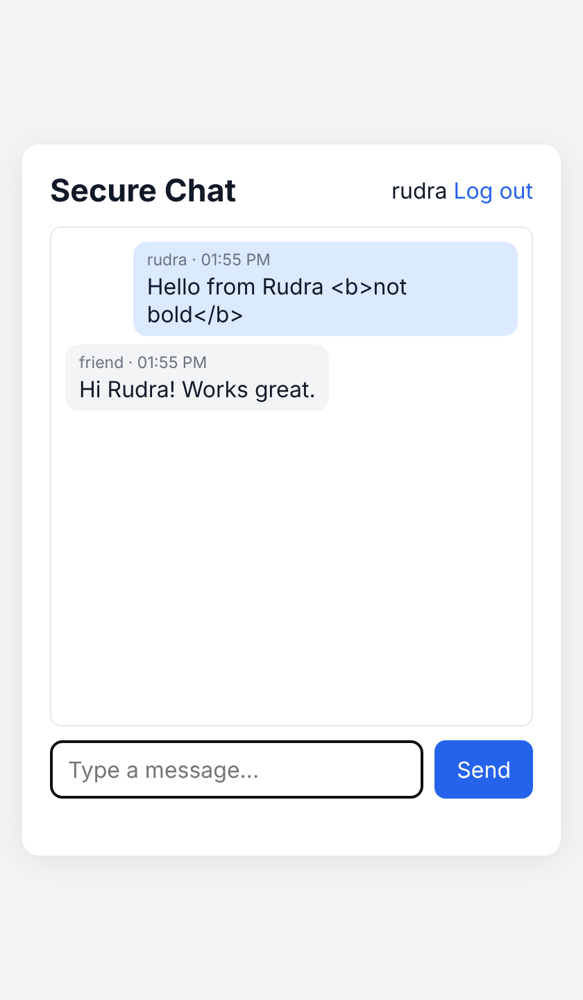

# Secure Chat (backend + built-in web client)

A real-time group chat where people **create an account, log in, and chat live**. Messages are saved, so anyone who joins sees the last 50 messages.



Built with Node.js, Express, Socket.IO and MongoDB.


## Features

- Sign up / log in with username + password (passwords hashed with bcrypt)
- Login tokens (JWT) that expire after 1 hour
- **Only logged-in users can join the chat**: the live connection checks the token
- Message history saved in MongoDB
- Brute-force protection on login (rate limiting)
- Clean, mobile-friendly web page with dark mode, served by the same server
- Automated tests that run on every push (GitHub Actions)

## Run it locally

You need [Node.js 18+](https://nodejs.org) and a MongoDB database (local, or a free [MongoDB Atlas](https://www.mongodb.com/atlas) cluster).

```bash
git clone https://github.com/arnabdharudra/chat-backend.git
cd chat-backend
npm install
cp .env.example .env      # then open .env and fill in MONGO_URI and JWT_SECRET
npm start
```

Open http://localhost:3000, create an account, and start chatting. Open a second browser window to chat with yourself.

## Run the tests

```bash
npm test
```

The tests start a temporary in-memory MongoDB, so no setup is needed.

## Project layout

```
src/
  server.js        starts the app (connects DB, listens on PORT)
  app.js           Express + Socket.IO wiring
  config.js        reads settings from .env and refuses weak secrets
  socket.js        live chat: token check, history, broadcasting
  routes/auth.js   /api/auth/register and /api/auth/login
  models/          User and Message database models
public/            the chat web page
test/              automated tests
```

## Using a separate front end

The [chat-app](https://github.com/arnabdharudra/chat-app) repo is the same web client packaged to be hosted on its own (e.g. GitHub Pages). To allow it, add its address to `ALLOWED_ORIGINS` in `.env`.

## API

| Method | Path | Body | Returns |
|---|---|---|---|
| POST | `/api/auth/register` | `{ username, password }` | `{ token, username }` |
| POST | `/api/auth/login` | `{ username, password }` | `{ token, username }` |
| GET | `/health` | — | `{ ok: true }` |

Socket.IO: connect with `auth: { token }`. Events: `chat history` (server → client), `chat message` (both ways).

## License

MIT
